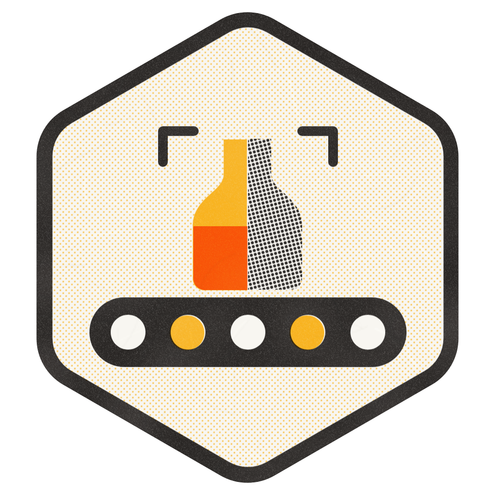
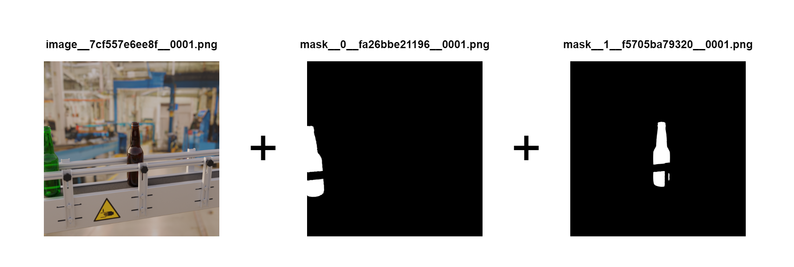
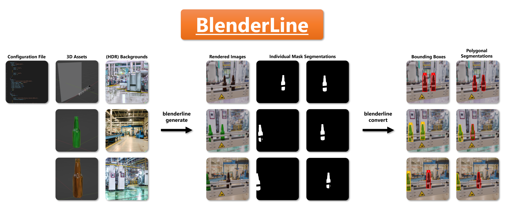

# BlenderLine

BlenderLine generates synthetic images of production lines using Blender scenes and configuration files. It renders images alongside object masks, providing labels for computer vision tasks such as object detection and segmentation. The repository includes a bottle conveyor example and tools for converting generated data into YOLO training formats.



Each generated instance contains a rendered image and a separate mask for each placed object. The conveyor can obscure parts of a bottle, leaving disconnected regions in its mask.

## Background

Collecting production-line images and labeling individual objects can take time, particularly when the dataset needs variations in lighting, backgrounds, and object placement. BlenderLine uses 3D models and a configurable scene to generate those variations together with their masks. This provides a way to build synthetic training data, though its usefulness on a real production line still needs to be evaluated with real images.

## Getting started

The package currently requires **Python 3.10**, not an arbitrary newer Python version. Rendering also requires a separate Blender installation with the `blender` command on your `PATH`, or a path supplied through `--blender`. Installing the Python package does not install that executable.

**Blender compatibility needs care.** The renderer uses a legacy compositor API. A smoke test with Blender 5.2.2 failed before rendering, so the example below is a workflow reference, not a verified end-to-end setup for current Blender releases. See [Limitations](#limitations) before generating a dataset.

### Install from source

Run these commands with Python 3.10 available on your system.

```sh
git clone https://github.com/maxvandenhoven/blenderline.git
cd blenderline
python3.10 -m venv .venv
source .venv/bin/activate
python -m pip install -e . requests
```

On Windows, activate the environment with `.venv\Scripts\activate` instead. The explicit `requests` dependency is needed because the CLI imports the example downloader at startup, but `setup.py` does not declare it. The package also declares a `bpy` dependency, whose wheel availability can constrain installation independently of the standalone Blender executable.

### Generate the example

The [example configuration](examples/example_beer/images.json) defines two training images and two validation images at 512 × 512 pixels. It uses two bottle models, background photographs, and HDR lighting assets included in the repository.

Before rendering, review the `scene` settings in that file. The example enables CUDA and uses 1,024 samples per image. Set `"render_use_cuda": false` for CPU rendering, and reduce `render_samples` for an initial test.

```sh
blenderline generate \
  --config examples/example_beer/images.json \
  --target data/raw
```

If Blender is not on your `PATH`, append `--blender /path/to/blender-directory`. This option takes the **directory containing the executable**, not the executable itself.

A successful run writes the dataset under `data/raw/example_beer`, with `train` and `valid` splits and a `label_mapping.json` file. Each numbered instance directory contains one image and its object masks.

```text
data/raw/example_beer/
├── label_mapping.json
├── train/
│   ├── 0/
│   │   ├── image__<image-id>__0001.png
│   │   ├── mask__<class-id>__<mask-id>__0001.png
│   │   └── ...
│   └── 1/
│       └── ...
└── valid/
    ├── 0/
    │   └── ...
    └── 1/
        └── ...
```

### Convert a dataset

Both `yolo_detection` and `yolo_segmentation` are implemented and exposed by the CLI. Conversion operates on existing image and mask files and does not launch Blender.

```sh
blenderline convert \
  --format yolo_detection \
  --source data/raw/example_beer \
  --target data/yolo_detection

blenderline convert \
  --format yolo_segmentation \
  --source data/raw/example_beer \
  --target data/yolo_segmentation
```

The source must be the dataset root containing `label_mapping.json`, not its parent directory. Choose a separate target that does not exist or is empty, and keep it outside the source dataset. Conversion preserves the source unless you explicitly request `--remove`, which prompts before deleting it.

Each converter creates `images/<split>/`, `labels/<split>/`, and an `example_beer.yaml` metadata file. Detection labels contain normalized bounding boxes, while segmentation labels contain normalized polygon coordinates. Review the YAML paths and class mapping in the training environment before using the output.

Use `--minarea` to filter small masks, with a default threshold of `0.005` of the image area. Detection measures foreground pixels, while segmentation measures contour area. For segmentation, `--eps-factor` controls polygon simplification and defaults to `0.005`. Larger values produce coarser polygons.

Both conversion commands passed local smoke tests on a small, constructed image-and-mask fixture. Those tests checked labels, normalized coordinates, split metadata, small-mask filtering, and rejection of a nonempty target. They did not validate model training or a complete render-to-training pipeline.

## How it works

The workflow moves from scene assets to configuration, rendering, and conversion.

1. **Prepare the scene and objects.** A scene `.blend` file supplies the production line, camera, placement path, and background object. Separate `.blend` files hold the objects to place on the line. The configured object names must match the Blender assets.
2. **Describe the dataset in JSON.** Configuration sets split sizes, class labels, render settings, object frequencies, spacing, and lateral placement limits. Asset paths are resolved relative to the configuration file, which keeps a project's scene and supporting assets together.
3. **Render images and masks.** The generator samples lighting and backgrounds, places objects along the configured path, and assigns each object a pass index. Blender's compositor uses those indices to write individual masks alongside the rendered image.
4. **Convert the raw dataset.** The converters read the mask filenames and label mapping, calculate bounding boxes or contours, and copy images into the target dataset's split directories.



The [beer conveyor example](examples/example_beer/) shows how these pieces fit together. Its labels distinguish green and brown bottles, and its configuration controls how frequently each model appears. Start by adapting that project rather than assuming an arbitrary Blender scene can be rendered without preparation.

## Limitations

- **Rendering is version-sensitive.** In a local CPU smoke test using a reduced version of the supplied example, Blender 5.2.2 raised `AttributeError: 'Scene' object has no attribute 'node_tree'` in compositor setup and produced no images. The earlier README's blanket “Blender 3.4+” claim should not be read as compatibility with every later release. A working Blender version still needs to be established for an end-to-end run.
- **An exit code alone does not confirm rendering succeeded.** The failed Blender smoke test returned exit code zero despite the Python traceback. Check the logs, output images, masks, and `label_mapping.json` before converting.
- **Segmentation conversion has boundaries.** Disconnected contours from one object become separate label lines. The converter also retrieves nested contours without treating holes separately. Inspect occluded objects and masks with holes before relying on the labels for instance segmentation.
- **YOLO metadata needs review.** The converter derives its dataset path from the target directory's last two path components and preserves JSON class keys as strings in YAML. Split names are recognized by the substrings `train`, `val`, and `test`. Check paths, class keys, and split assignments against your training tool rather than assuming any directory layout will work unchanged.
- **COCO conversion is not implemented.** The available conversion formats are `yolo_detection` and `yolo_segmentation`. Neither COCO detection nor COCO segmentation is exposed by the CLI.
- **Synthetic labels are not evidence of real-world accuracy.** Scene geometry, materials, lighting, and placement constraints determine the generated variation. Evaluate the resulting data against the production conditions and task you care about.

## Development

The CLI can also run directly from a checkout with `python -m blenderline.command_line`. These help commands describe the available arguments without starting a render or downloading assets.

```sh
blenderline --help
blenderline generate --help
blenderline convert --help
blenderline download --help
```

Install the development dependencies with `python -m pip install -e '.[dev]' requests`. The [Makefile](Makefile) provides `make lint` for Flake8 and `make docs` for the Sphinx documentation. `make format` rewrites Python files with Black and isort.

The [documentation source](docs/source/) contains the user guide and API and CLI references, although some guide pages are still placeholders. Implementation details live in [dataset settings](blenderline/settings/image.py), [generation](blenderline/generators/image.py), and the [converters](blenderline/scripts/python/converters/).

## License

BlenderLine is licensed under the GNU General Public License v3. See [LICENSE](LICENSE) for the terms.
